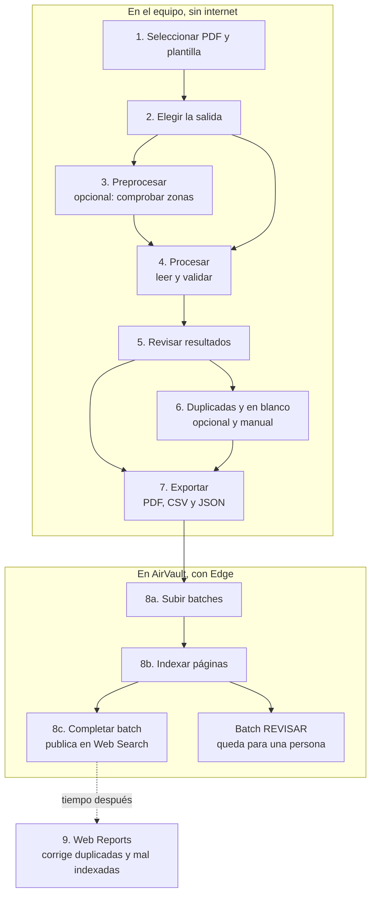
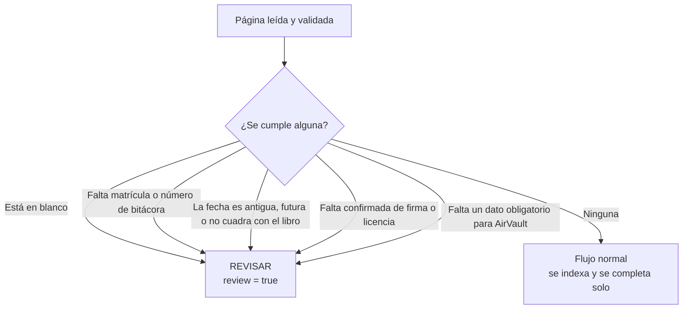
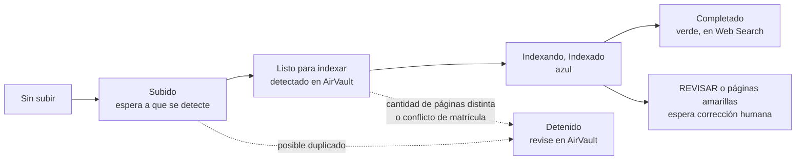
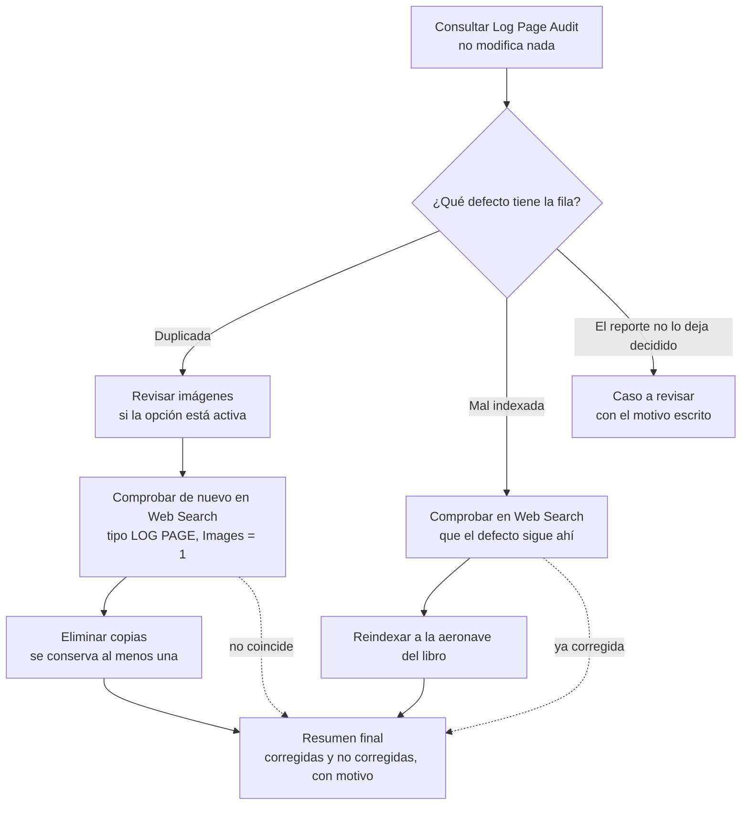

# BITS: manual de uso

BITS lee bitácoras escaneadas, organiza los resultados y prepara su carga en AirVault. Una **ejecución** es el conjunto de PDF procesados juntos y sus resultados. Una **plantilla** indica dónde buscar cada dato del formulario. El **OCR** convierte la escritura de la imagen en texto.

Abra `BITS.exe` desde la carpeta completa del programa. La lectura funciona localmente, sin internet y usando el procesador. Para AirVault necesita conexión, Microsoft Edge y una cuenta autorizada. Consulte la [guía técnica](TECNICO.md) para mantenimiento.

## Vista general

El trabajo tiene dos mitades. La primera ocurre en el equipo y sin internet: leer los PDF, validar lo leído y armar la entrega. La segunda ocurre en AirVault: subir esa entrega, indexar cada página y publicarla. Web Reports es un paso aparte, para corregir lo que ya está publicado.

El botón **Automático** encadena los pasos 3, 4 y 7, y opcionalmente 8a, 8b y 8c. Revisar, depurar y atender **REVISAR** siempre quedan en manos de una persona.

Una regla atraviesa todo el proceso: **lo que BITS no puede sostener con evidencia no lo inventa, lo aparta en REVISAR**. Por eso una entrega siempre tiene dos partes: la que se indexa y publica sola, y la que espera revisión humana.

## Proceso paso por paso

### 1. Seleccionar los archivos y la plantilla

1. Pulse **Seleccionar…**, junto a **Archivos**, y elija uno o varios PDF. Si los copió a `input/`, use **Carpetas -> Detectar input**.
2. Compruebe los archivos y la cantidad de páginas indicada. La interfaz procesa todos los PDF seleccionados; el cuadro **Página** sirve para navegar, no para limitar el procesamiento.
3. Elija la **Plantilla** correspondiente al formulario. Para el formato habitual, use `aircraft_log`. **Buscar…** permite abrir otra plantilla.
4. Mantenga **Verificar matrículas** activado para contrastar las lecturas con la flota. **Editar flota…** permite actualizar esa lista.

No mueva ni modifique los originales durante el trabajo. Al terminar correctamente, los PDF tomados directamente de `input/` pasan a `input/processed/`; los elegidos fuera de esa carpeta permanecen en su ubicación.

### 2. Elegir la salida

Configure el recuadro **Salida** antes de procesar:

| Opción                                   | Para qué sirve                                                                                                 |
| ---------------------------------------- | -------------------------------------------------------------------------------------------------------------- |
| **Formato: Un solo PDF**                 | Reúne la entrega con sus secciones. Es el formato necesario para AirVault, aunque después se divida en partes. |
| **Formato: Varios PDF**                  | Crea archivos separados según las agrupaciones elegidas.                                                       |
| **Separación -> Matrícula / Mes**        | Agrupa por aeronave, por mes o por ambos.                                                                      |
| **Separación -> Posibles discrepancias** | Añade un apartado para revisar posibles faltas de firmas o licencias.                                          |
| **Separación -> Errores**                | Genera `errores.pdf` con páginas que requieren revisión manual.                                                |
| **Dividir cada**                         | Divide la entrega única según el máximo de páginas indicado, contando separadores y respetando las secciones.  |
| **Fecha: Fin de mes**                    | Escribe el último día del mes reconocido. Si procesa así, BITS omite la lectura del día manuscrito.            |
| **Fecha: Día exacto**                    | Lee el día y lo usa en el CSV; si falta, representa la fecha a fin de mes cuando dispone de mes y año.         |

Una ejecución que leyó el día puede exportarse o indexarse a fin de mes sin repetir OCR. Para recuperar el día manuscrito de una ejecución procesada con **Fin de mes**, debe procesarla otra vez con **Día exacto**.

### 3. Preprocesar y comprobar las zonas

**Preprocesar** prepara la imagen para leerla: corrige la inclinación y alinea el formulario con la plantilla. Sirve para comprobar que las zonas de lectura caen sobre los datos correctos. Esta acción no reconoce texto ni genera la entrega.

1. Abra **Campos** y marque **Visualizar campos**.
2. Pulse **Más acciones -> Preprocesar** y espere a que termine.
3. Recorra varias páginas con las flechas o escribiendo el número en **Página**. Compruebe especialmente matrícula, número de bitácora y fecha.
4. Use los controles de acercar, alejar y ajustar la página para inspeccionar los recuadros.
5. Si las zonas quedan desplazadas, revise la plantilla antes de procesar.

**Campos -> Columnas importantes** limita los recuadros a los campos elegidos. **Elegir columnas importantes…** permite cambiar esa selección, que también se usa en las tablas y el CSV principal. Los recuadros son ayudas de pantalla y no aparecen en los PDF exportados.

### 4. Procesar

**Procesar** realiza la lectura completa: prepara las imágenes, reconoce los datos, comprueba fechas y matrículas, detecta duplicados y examina las firmas. Guarda los resultados para revisarlos y exportarlos.

1. Confirme archivos, plantilla y opciones de salida.
2. Pulse **Procesar**. Incluye el preprocesado; no es obligatorio ejecutarlo antes por separado.
3. Espere a **Procesamiento terminado**. La pantalla muestra el avance, los tiempos y los resultados.
   Cada documento hace una segunda vuelta sobre las hojas a las que les falta una firma, buscando en la imagen una marca **VOID** que anule ese reclamo. La barra la anuncia como *Comprobando marcas VOID en hojas sin firma*, cuenta hojas (no páginas) y está incluida en el tiempo estimado.
4. Revise los datos antes de crear la entrega con **Exportar**.

La aplicación ajusta internamente la alineación, los recortes y el uso del procesador. Para interrumpirla, pulse **Cancelar** y espere a que se detenga; una ejecución cancelada no es una entrega final.

### 5. Revisar los resultados

Haga doble clic en una fila para localizar su página. También puede buscar un número de bitácora, matrícula u otro texto y recorrer las coincidencias.

En **Plantilla -> Visor de CSV…**, escriba los **siete dígitos** de una bitácora y pulse **Buscar** o Intro. La consulta recorre todos los reportes locales de `output/`, `input/` (incluido `processed/`) y las carpetas abiertas en ese visor, aunque la ejecución ya no aparezca entre las 25 del historial. Funciona sin abrir primero un CSV. El CSV mínimo y su compañero completo cuentan como un solo reporte; las copias en distintos batches se conservan como coincidencias distintas.

Las flechas **‹ / ›**, o Intro repetido, recorren las coincidencias y abren su batch y página. El texto junto al buscador identifica la bitácora, el batch, el archivo y la página. Para buscar parte del número use `bit:12345`; una matrícula, un archivo u otro texto sigue buscando en las columnas visibles del CSV abierto. La búsqueda usa los datos ya reconocidos: un PDF sin reporte todavía necesita procesarse. Si un reporte cambia, desaparece o no se puede leer, el visor lo indica; pulse **Buscar** de nuevo para actualizar la consulta.

| Dato o estado | Qué significa                                                                                                   |
| ------------- | --------------------------------------------------------------------------------------------------------------- |
| `OK`          | Los datos principales se leyeron sin dudas pendientes.                                                          |
| `WARNING`     | Hay una lectura débil, un dato inferido o algo por confirmar.                                                   |
| `ERROR`       | La página está en blanco o no se pudieron resolver los datos principales.                                       |
| `review`      | La página se separa en **REVISAR**. El sistema puede guardar los datos disponibles, pero queda revisión humana. |
| `dup`         | El número de bitácora ya apareció en la ejecución.                                                              |
| `disc`        | Se confirmó una falta de firma o licencia requerida.                                                            |
| `disc_reason` | Explica la falta confirmada.                                                                                    |

Cada página termina en uno de dos destinos. Estas son las condiciones que la mandan a **REVISAR**; basta una:

Un `WARNING` por sí solo no manda la página a **REVISAR**: si matrícula, número y fecha son utilizables, la página sigue en el flujo normal.

Compruebe matrícula, número de bitácora y fecha. El número tiene siete dígitos. Cada libro contiene 50 páginas de una sola aeronave: los finales `00` a `49` pertenecen a un libro y `50` a `99` al siguiente. Dentro del libro, la fecha puede repetirse, pero no retroceder al aumentar el número.

Las fechas de años anteriores pasan a revisión, salvo durante enero, cuando también se admite el año anterior. Una fecha manuscrita futura necesita corrección; una fecha representada a fin de mes se comprueba por mes. La marca **VOID** confirmada elimina el reclamo de firmas de una página anulada, pero no resuelve datos de identidad o fecha faltantes.

### 6. Revisar páginas repetidas y en blanco

Depurar retira páginas de los resultados, como duplicados o blancos, después de que usted las revise.

1. Pulse **Más acciones -> Duplicadas y en blanco**. El visor de CSV ofrece el mismo botón.
2. Elija **Duplicados**, **Páginas en blanco** o ambas opciones.
3. Cada grupo muestra **Número de bitácora** y sus siete dígitos. Seleccione una página para comparar sus imágenes; seleccionar una fila no la excluye. Puede acercar, alejar o ajustar cada imagen con los controles de zoom, o usar Ctrl y la rueda del ratón. Si hay más de dos apariciones, use **Comparar con** para elegir otra página del grupo.
4. Marque o desmarque cada página con su casilla o con Enter. **Se conservará** y **Se excluirá** muestran el resultado de las marcas. Pulse **Excluir N páginas** para aplicarlas. Se actualizan los datos procesados; los archivos originales se conservan.
5. Exporte de nuevo para que la entrega refleje la depuración.

Se conserva al menos una aparición de cada bitácora repetida y no se permite vaciar toda la ejecución. Depurar es una acción manual y no forma parte del proceso automático.

Para corregir una decisión, vuelva a **Duplicadas y en blanco** y pulse **Restaurar última exclusión**. Recupera exactamente los datos anteriores, sin repetir el reconocimiento de texto, incluso después de cerrar y volver a abrir la ejecución. Después exporte para actualizar la entrega. Solo se conserva el respaldo de la última exclusión; si los datos cambiaron después, la restauración se bloquea para conservar esos cambios. Un fallo al guardar repone los datos anteriores y mantiene el respaldo previo.

### 7. Exportar

1. Revise las opciones de **Salida**.
2. Pulse **Más acciones -> Exportar**.
3. Abra la carpeta de la ejecución en `output/` y compruebe los PDF generados.

La carpeta contiene `datos/` con el CSV principal, el CSV completo y el JSON, además de `stats.json` y los PDF de entrega. Con **Un solo PDF** se genera también `_paginas.json`, que relaciona cada página exportada con sus datos para AirVault.

Exportar vuelve a generar los datos y PDF sin repetir OCR. Conserva los PDF anteriores y numera las nuevas copias con sufijos como `-2` o `-3`. Para reexportar necesita el JSON, la plantilla y los PDF originales.

### 8. Subir e indexar en AirVault

**Subir** envía los PDF. **Indexar** asigna a cada página sus datos de búsqueda: aeronave, número de bitácora, fecha y demás campos configurados. Un **batch** es un lote de páginas dentro de AirVault. **Completar** cierra un batch válido y lo envía a Web Search.

1. Conserve matrícula, número de bitácora y fecha en el CSV principal de la ejecución procesada.
2. Pulse **Indexar en AirVault…**. Seleccione una o varias ejecuciones en el historial, que lista las últimas 25. También puede marcar las que aparecen en gris: al pulsar **Empezar**, BITS prepara automáticamente los PDF y la información de páginas que falten antes de subirlas. Usa los resultados guardados, conserva los CSV y no repite OCR. Si falta el original o los datos procesados están incompletos, informa el motivo y no envía la selección. Las entregas ya válidas se reutilizan.
3. Revise **Nombre del batch**, **Máximo por batch** y **Fecha**. Deje **Sesión** vacío: BITS abre su propio Edge si hace falta. Complete el inicio de sesión y el segundo factor cuando se soliciten.
4. Para controlar cada etapa manualmente, desmarque **Indexar páginas** y **Completar batch** en **Automatización**.
5. Abra **Acciones -> Vista previa…**. Compruebe el reparto y use **Ver las bitácoras…** para revisar el contenido previsto. El recuadro **Resultado** resume cuántas van al flujo normal y cuántas a **REVISAR**.
6. Pulse **Subir a AirVault**. Espere a que los batches aparezcan confirmados. Si la revisión periódica está apagada, pulse **Revisar en AirVault**.
7. Revise las incidencias y pulse **Indexar** para escribir las páginas que estén listas. Los conflictos permanecen visibles.
8. Para publicar los batches normales, active **Completar batch** antes de indexar o use **Completar el batch** en el menú de una fila indexada. Solo se completa cuando todas sus páginas son válidas.
9. Revise el estado final y atienda por separado el batch **REVISAR**.

En **REVISAR**, BITS guarda los campos disponibles y verifica lo escrito. Si una página suelta en verde ya tiene en AirVault otro número de bitácora, alguien la validó así: BITS no la pisa ni la espera, queda para quien revisa y el batch termina su parte automática. Las páginas con incidencias pueden seguir amarillas, pendientes de corrección humana, aunque termine el trabajo automático. Ese batch conserva sus separadores y no se completa ni publica automáticamente.

Así avanza cada batch de la cola. Cada paso queda anotado en el equipo, por eso **Continuar pendiente** retoma desde el primero que falte sin repetir lo ya confirmado:

La columna **Estado** usa rótulos cortos. El **?** junto a **Cola de AirVault** explica cada uno con su color, y el detalle de un batch aparece al posar el puntero sobre su estado. La cola muestra azul mientras se indexa (**Indexando**) y mientras el batch esté indexado o incompleto. Solo muestra verde al completar, es decir, al cerrarlo con **Complete**. Una página que conserve el estado 3 no convierte el batch en completado.

La barra de avance cuenta la cola entera, desde subir el primer batch hasta completar el último. Mientras hay trabajo, la última línea de la bitácora dice **En curso** y gira; entre revisiones dice **En espera** y cuánto falta para la siguiente. El mismo arco gira en la cola, bajo el número de cada batch que se está subiendo, revisando, indexando o consultando en ese momento. Si no aparece ninguna de las dos, el proceso está detenido. Los mensajes inferiores ocupan una línea; coloque el puntero encima para leer el texto completo.

Con **Indexar páginas** activo, las subidas van de una en una y el indexado avanza mientras tanto: se sube un PDF y, mientras AirVault lo arma, se indexa (y se completa, si corresponde) el batch anterior ya confirmado; cuando AirVault confirma el nuevo, sale el siguiente. Nunca hay dos cargas en vuelo, porque AirVault las junta. La espera a que aparezca cada carga en AirVault también sigue ese orden. Las verificaciones de batches disponibles, sus páginas y las consultas a Web Search se reparten entre varias conexiones, con un límite compartido por cada recorrido. Las páginas también se escriben en paralelo; si AirVault no lo aprovecha, BITS vuelve solo a una. Si un batch tarda más que la espera máxima en aparecer, la cadena se detiene ahí; lo ya confirmado se indexa igual y la revisión periódica retoma el resto.

Lo primero que hace el proceso es confirmar dónde está cada batch, todos de una vez y antes de esperar o subir nada. El registro deja una línea por batch (con el número que tiene en la barra lateral, su nombre y su estado) y después la clasificación: cuáles se suben, cuáles esperan porque AirVault todavía los arma, cuáles están en Web Index y se indexan, cuáles están en Web Search o completados, y cuáles no están en Web Index y se buscan en Web Search. Esa búsqueda arranca en ese momento, sin esperar al final: si las bitácoras están publicadas el batch queda confirmado, y si no, se vuelve a subir en su turno y se espera a que AirVault lo cargue. Antes de subir o de volver a subir cualquier archivo se atiende lo que ya está en Web Index: se indexa el batch que está listo, se reintenta el incompleto al que le toca y, con **Completar batch**, se completa el indexado. Con eso hecho se sigue con el resto. La línea azul **Ahora** y el registro nombran cada batch con el número de la barra lateral y su nombre; el ID es de AirVault, solo existe cuando el batch ya salió en Web Index y se ve en su tarjeta. Lo único que una carga en vuelo impide es subir otra; mientras tanto se sigue revisando e indexando. Si hay varias cargas en vuelo, se miran todas en cada vuelta y la que aparece se indexa enseguida, sin esperar a que venza el plazo de las demás.

**Empezar** pone en proceso todos los batches de la cola que no estén terminados, también los de otras ejecuciones que sigan a la vista y aunque no haya ninguna ejecución elegida; los omitidos y los cancelados no entran. Si la ejecución quedó a medias, **Empezar**, **Revisar en AirVault** y **Continuar pendiente** retoman todo lo que falte: esperan a que AirVault confirme la carga que siga armándose, la indexan, suben los batches que faltan, los indexan y, con **Completar batch**, los completan. Lo ya hecho no se repite. **Revisar en AirVault** lo hace aunque **Revisar cada** esté apagado.

Si AirVault aceptó un archivo y no lo publicó, el batch pasa a **No encontrado en AirVault** cuando vence su plazo y la cola no lo contiene con ningún nombre. BITS no espera una orden: busca sus bitácoras en Web Search y, si tampoco están publicadas, vuelve a subir el archivo; si ya están publicadas, lo marca como confirmado y no lo toca. Solo se resube solo el archivo que nunca llegó a aparecer en Web Index, y como mucho dos veces. El que ya estuvo en Web Index con su ID y salió de la cola no se vuelve a subir solo: salir de la cola es lo que pasa cuando alguien lo completa o lo borra, y Web Search tarda en mostrar lo recién completado. Se sigue buscando en Web Search, que lo marca como confirmado en cuanto sus bitácoras aparecen, y el registro lo nombra con el ID que tuvo y lo que hay que mirar. Si en AirVault no está, clic derecho en su fila y **Subir a AirVault ahora** lo vuelve a poner en proceso; lo mismo con el que agotó sus reenvíos. Cada envío, detección y reenvío queda anotado en el manifiesto del batch. Para entrar en AirVault, BITS usa el enlace SSO en Edge y reutiliza su sesión.

#### Opciones de AirVault

| Opción                                     | Función                                                                                                                 |
| ------------------------------------------ | ----------------------------------------------------------------------------------------------------------------------- |
| **Máximo por batch**                       | Limita cada carga, incluidos sus separadores. Conserva los batches ya subidos.                                          |
| **Fecha**                                  | Permite fin de mes o día exacto, si la ejecución leyó el día.                                                           |
| **Revisar cada**                           | Consulta la disponibilidad cada 1 a 60 minutos mientras la ventana sigue abierta. Apagado, use **Revisar en AirVault**. |
| **Automatización**                         | Elige hasta dónde continúa el trabajo sin nuevos clics.                                                                 |
| **Continuar pendiente**                    | Retoma desde el primer paso sin terminar y conserva lo confirmado.                                                      |
| **Reiniciar paso incompleto**              | Reinicia el estado local del batch elegido, o de los incompletos si no seleccionó uno. No borra datos remotos.          |
| **Buscar** y flechas                       | Localizan bitácoras y recorren las coincidencias.                                                                       |
| **Mostrar solo la ejecución seleccionada** | Limita la cola visible a esa ejecución.                                                                                 |
| **Cancelar**                               | Detiene el trabajo y libera los batches abiertos; conserva lo escrito.                                                  |
| **Detener subida si se detectan duplicados** | Marcada: bloquea el batch sospechoso. Desmarcada: muestra el aviso y continúa con la subida, el indexado y el completado solicitado. Se recuerda al cerrar; inicialmente está desmarcada. |

Con clic derecho sobre un batch puede subirlo, revisarlo, indexarlo, completarlo, cancelar o reanudar su cola, ver sus bitácoras y copiar su nombre o identificador. Solo se habilitan las acciones que corresponden a su estado.

**No es duplicado: volver a subir** autoriza un reenvío: úselo después de revisar en AirVault que la carga realmente falta. **Eliminar el batch…** actúa sobre el batch remoto; **Eliminar el registro de AirVault** quita el seguimiento local. **Eliminar la ejecución…**, en el historial, envía la carpeta local a la Papelera y conserva lo que ya está en AirVault.

La comprobación de duplicados sigue generando avisos con la casilla desmarcada. La alerta queda guardada en el manifiesto y visible en la cola. Esto no vuelve a subir una carga que AirVault ya tiene: primero se identifica el batch existente, y solo se reenvía sola la que no está en la cola ni en Web Search.

En cada revisión BITS mira además la cola entera de Web Index en busca de batches subidos dos veces. Reconoce la copia de cualquier batch de la barra lateral, también de uno ya completado: tiene su título (con «-Batch» al final si se subió por la web, o es un Empty-Batch con ese nombre por dentro), sus mismas páginas y sus mismas bitácoras. Solo la da por copia cuando el original ya está a salvo: sigue en Web Index, ya se completó o ya se indexó entero. El registro la anota con su ID, de qué batch es copia, en qué quedó el original y **Se debe borrar**; lo repite solo cuando cambia la lista, dice cuándo ya no está y el final del proceso recuerda cuántas quedan. Si un batch que este equipo no lleva está dos veces, con el mismo título, páginas y bitácoras (lo subió otro equipo), el registro da los dos ID: hay que borrar el que no lleve la barra lateral del equipo que lo subió. BITS no borra nada en AirVault.

Antes de subir un batch que todavía no tiene ID, por su cuenta o por orden, BITS busca en Web Index la misma carga con otro título: subida por la web (con «-Batch» al final) o desde otro equipo (un Empty-Batch con su nombre por dentro), con sus páginas y sus bitácoras. Si hay una, la toma, le devuelve su título y no sube el archivo; el registro dice con qué ID. Si hay varias, o una que aún no se puede comprobar (alguien la tiene abierta o AirVault todavía no lee sus páginas), no sube nada y el registro dice cuáles son y qué hacer: si es esta carga, póngale en Web Index el título del batch y BITS la toma en la siguiente revisión.

Si un batch indexado que BITS no completa (**REVISAR**, o cualquiera sin **Completar batch**) ya no está en Web Index, el registro lo dice una vez: alguien lo completó o lo borró. **Verificar subidas en Web Search**, en sus acciones, lo marca como **Completado** si sus bitácoras ya están publicadas.

Mientras **Revisar cada** esté activo, la cola sigue consultando hasta que todo quede indexado: los batches por armar, los listos cuyo indexado se cortó y los incompletos. Las páginas amarillas se reintentan solas: seguido mientras cada intento deje menos, y después cada 20 minutos, hasta seis veces. Cada reintento lee y escribe solo las páginas que siguen pendientes, no el batch entero. Si AirVault leyó por su cuenta otro número de bitácora en una página suelta que sigue en amarillo, BITS comprueba cuál de los dos es el correcto antes de escribir: el número bueno tiene que caer en un libro del avión de esa página, según las demás bitácoras del batch. Si el correcto es el de BITS, escribe sus datos; si es el de AirVault, conserva ese número y escribe el resto; si no puede decidirlo, no toca la página y la deja para revisión. Cuando lo único que falta es algo que BITS no escribe (por ejemplo, una página que alguien dejó en verde con otro número), no se reintenta: el batch queda como indexado incompleto, el proceso sigue mirándolo cada 10 minutos como poco y, en cuanto alguien lo corrige en Web Index, lo da por indexado y, con **Completar batch**, lo completa. Si AirVault falla varias veces seguidas, la revisión no se apaga: pregunta cada 15 minutos hasta que vuelva. Tampoco se apaga si pasan dos horas sin ningún cambio en la cola: sigue cada 30 minutos hasta terminar todos los batches, y cualquier cambio le devuelve su ritmo. Un batch que AirVault no deja leer o indexar no detiene a los demás: se anota con su motivo, el proceso sigue con el siguiente y ese batch se vuelve a intentar en la próxima revisión. Si **Completar batch** está marcado, también sigue pendiente de los indexados que todavía no se han completado, incluidos los que AirVault no dejó cerrar en un intento anterior; tras tres cierres rechazados lo vuelve a pedir cada 30 minutos. El proceso no se da por terminado mientras quede algo sin indexar o sin completar, salvo lo cancelado y lo que dejan fuera las casillas **Omitir**. Los batches completados salen de la espera; **REVISAR** sigue reservado para corrección humana. Puede cancelar o desactivar la revisión periódica en cualquier momento.

AirVault deja abrir cada batch a un solo usuario. Si un batch pendiente figura abierto con su propio usuario, BITS lo suelta y sigue trabajando; al pausar, cancelar o cerrar el programa suelta todos los que tenga a su nombre. Si lo tiene abierto otro usuario, BITS no lo toca: la tarjeta del batch pasa a amarillo y dice **abierto por otro usuario** (el nombre aparece al posar el puntero), y el registro lo anota aparte de los que se indexan. Mientras BITS no haya podido comprobar cuál es su usuario, la tarjeta dice solo **abierto en AirVault**. Se retoma solo cuando ese usuario lo cierra en Web Index.

La última línea de la bitácora dice siempre en qué está el proceso: el batch y el paso en curso mientras trabaja, o cuánto falta para la próxima revisión, cuántos batches tienen pasos pendientes y si la espera es por AirVault, por un reintento tras un fallo o porque la cola lleva horas sin cambios. Si el proceso se detiene con batches sin terminar (porque **Revisar cada** está apagado o porque lo que falta necesita una decisión, como un posible duplicado), la bitácora lo dice con la lista de esos batches, lo que le falta a cada uno y cómo continuar.

### 9. Corregir excepciones con Web Reports

Log Page Audit es un reporte de AirVault que señala dos defectos de lo ya publicado: una bitácora **duplicada**, que aparece más de una vez, y una **mal indexada**, archivada bajo una aeronave que no es la de su libro. **Web Reports…**, en la ventana principal, consulta ese reporte y corrige lo que el propio reporte deja decidido.

1. Pulse **Web Reports…** y elija **Desde** y **Hasta**. Se muestran como día/mes/año y se envían a AirVault como mes/día/año. Se deben indicar ambas fechas y ninguna puede superar el día actual. En **Mostrar** elija mal indexadas, duplicadas o ambas.
2. Ajuste los mismos parámetros de AirVault: **Repositorio**, **Tipo de libro** ((ALL), Copa-6 o Copa-7), **Aeronaves**, **Bitácoras**, **Mínimo de páginas** (5, 10, 25, 40 o 50), **Orden** y **Refresh**. Los desplegables conservan los nombres y opciones originales de AirVault, excepto **Mostrar**. Los campos vacíos de aeronaves y bitácoras dejan la consulta sin esos filtros. **Refresh** inicia en **YES**, que pide regenerar los datos en AirVault; **NO** usa su reporte guardado. **For Export** se envía siempre como **NO** y no aparece como opción.
3. Pulse **Consultar**. Consultar no modifica nada en AirVault.
4. Revise la tabla. **Matrícula del libro** es la aeronave que le corresponde a la bitácora; **Matrícula indexada**, aquella bajo la que quedó archivada. En una mal indexada las dos difieren, y esa diferencia es el defecto. En una duplicada la segunda queda vacía: el reporte no la indica.
5. Las celdas subrayadas abren Web Search: la de **Página**, sus apariciones; la de **Rango del libro**, el libro entero. Se pueden abrir varias bitácoras y libros mientras se consulta o corrige, sin detener el trabajo.
6. Pulse **Corregir todas…**, o seleccione filas con Ctrl o Mayús y pulse **Corregir seleccionadas…**. Confirme el resumen.

La consulta lee todas las páginas de cada reporte y conserva el libro de las filas de continuación. La frase de estado indica la página que está leyendo. Si falla la navegación o cambian los parámetros, informa el error y no presenta una consulta incompleta como terminada. Las fechas se aplican con el criterio del reporte de AirVault; el rango de fechas mostrado por un libro puede extenderse fuera del intervalo consultado.

**Revisar imágenes antes de eliminar copias** abre un único visor durante la corrección. Las copias aparecen en una lista vertical a la izquierda, con la imagen elegida en grande a su lado. El visor permanece abierto al eliminar u omitir y muestra la siguiente bitácora en la misma ventana. La selección inicial conserva la más antigua. Puede cambiar las marcas, omitir la bitácora o pulsar **Eliminar seleccionadas**. Siempre debe conservar al menos una copia en Web Search. **Cancelar** o la **X** del visor detienen el proceso, incluso después de ordenar un borrado; las copias ya eliminadas no se recuperan. Las miniaturas se guardan en memoria mientras la ventana siga abierta, para reutilizarlas si el documento no cambió. Si desactiva la opción, la corrección conserva automáticamente la copia más antigua.

La barra indica **Lectura** o **Corrección**, cada una con su propio porcentaje de 0 a 100 %. Durante la lectura cuenta las páginas de cada reporte; si AirVault todavía no confirma el total, lo indica y espera ese dato para calcular el porcentaje. Al finalizar la lectura, el resumen muestra cuántas páginas del reporte se leyeron. Durante la corrección, el porcentaje cuenta las bitácoras terminadas. Cancelar conserva el porcentaje alcanzado.

Solo se eliminan documentos de tipo **LOG PAGE** con **Images = 1**. Si cualquiera tiene varias imágenes, falta ese recuento o el tipo corresponde a otra área, se bloquea el grupo y se informa el motivo. Justo antes de eliminar se vuelve a comprobar que las copias coincidan con las revisadas y que la que debe conservarse siga presente. Esto protege documentos de Fleet u otras áreas incluidos en la búsqueda.

Una mal indexada se pasa a la aeronave de su libro. Antes de escribir, cada caso se contrasta con lo que Web Search muestra en ese momento: si el reporte quedó viejo y alguien ya lo corrigió, la bitácora se deja como está.

Si una duplicada del reporte aparece una sola vez en Web Search, BITS comprueba que la búsqueda esté completa y vuelve a cargarla una vez. Solo si sigue apareciendo el mismo documento de una sola imagen, muestra **Reporte desactualizado** en el aviso de corrección incompleta y deja esa bitácora sin modificar. La comprobación adicional se hace únicamente al encontrar esa diferencia durante la corrección; consultar el reporte no revisa cada fila en Web Search. Si la búsqueda cambia, queda incompleta o no permite identificar el documento, informa que no pudo confirmarlo.

Mientras algo corre en Edge, el cronómetro junto a la barra de progreso dice lo mismo que el de la ventana principal: **Estimado**, **Restante** y **Transcurrido**. La cuenta va por bitácora, no por página, y se ajusta con lo que tardan de verdad las de esta corrida. La primera vez parte de una estimación de fábrica; a partir de ahí usa lo que costó la última consulta o corrección completa en este equipo. Una corrida cancelada no cuenta para eso.

Los casos se corrigen uno a uno y son independientes. Que uno falle no detiene los demás: al terminar, el resumen dice cuántas se corrigieron y cuántas no, y un aviso enumera cada bitácora que quedó sin cambiar con el motivo que dio AirVault. Los motivos habituales son que la página esté tomada por otro usuario y que Web Search ya no muestre lo que decía el reporte.

**Las copias borradas no se pueden recuperar desde BITS.**

## Proceso automático

1. Seleccione PDF y plantilla y configure **Salida**, como en los pasos 1 y 2.
2. Si va a usar AirVault, revise antes sus opciones de carga e inicio de sesión.
3. Abra la flecha de **Automático** y elija hasta dónde continuar.
4. Pulse el cuerpo del botón **Automático** para iniciar la cadena.
5. Siga la línea de pasos y revise el resultado final, especialmente **REVISAR**.

| Paso                 | Qué hace y si se puede elegir                                                                           |
| -------------------- | ------------------------------------------------------------------------------------------------------- |
| **Preprocesar**      | Prepara las imágenes. Siempre incluido.                                                                 |
| **Procesar**         | Lee y valida los datos. Siempre incluido.                                                               |
| **Exportar**         | Genera la entrega. Siempre incluido.                                                                    |
| **Subir a AirVault** | Opcional. Carga los batches y espera a que estén disponibles.                                           |
| **Indexar páginas**  | Opcional. Escribe cada batch listo y retira los separadores del flujo normal. Activa también la subida. |
| **Completar batch**  | Opcional. Completa los batches normales válidos. Activa los pasos anteriores de AirVault.               |

Si desactiva **Subir a AirVault**, la cadena termina al exportar. La espera forma parte de la subida y se muestra como **Esperar**. Las opciones se conservan al cerrar y se comparten con el menú **Automatización** de AirVault.

**Cancelar** detiene la cadena. Para una interrupción de AirVault, vuelva a abrir la ejecución y use **Continuar pendiente**. La depuración sigue siendo manual.

## Visor de CSV

Abra **Herramientas -> Visor de CSV…** para consultar una ejecución guardada sin volver a procesarla.

1. Elija una ejecución en **Historial**, o pulse **Seleccionar carpeta…** o **Seleccionar CSV…**.
2. Elija el **Archivo CSV**. Seleccione una fila para abrir su página original.
3. Busque texto con **Buscar** o Enter y recorra las coincidencias con las flechas.

| Control                                      | Qué permite                                                                                                                    |
| -------------------------------------------- | ------------------------------------------------------------------------------------------------------------------------------ |
| Cabeceras de la tabla                        | Ordenar los resultados.                                                                                                        |
| Selector de columnas, cuando está disponible | Alternar entre columnas importantes y todas las del CSV completo. El botón contiguo permite elegir las importantes.            |
| **PDF de origen**                            | Cambiar de documento dentro de la ejecución.                                                                                   |
| **Página** y flechas                         | Ir a una página o recorrer el conjunto.                                                                                        |
| Acercar, alejar y ajustar                    | Inspeccionar la imagen o verla completa.                                                                                       |
| **Ubicar PDF…**                              | Localizar los originales si se movieron.                                                                                       |
| Casillas y **Supr**                          | Marcar páginas y quitarlas de la ejecución tras confirmar. La barra espaciadora alterna las marcas de las filas seleccionadas. |
| **Duplicadas y en blanco**                   | Revisar y retirar páginas duplicadas o en blanco.                                                                             |
| **Salida** y **Exportar**                    | Cambiar la organización y volver a generar la entrega sin OCR.                                                                 |

La tabla permite consultar datos; sus celdas no se editan directamente. Depurar, quitar páginas y exportar requieren los archivos asociados de la ejecución. Después de retirar páginas, vuelva a exportar.

Los cambios de **Campos importantes** de la ventana principal se reflejan también en el visor de CSV abierto, para la misma plantilla.

Cada exportación conserva en `logs/` su plantilla y las opciones aplicadas. Consulte [la auditoría de cambios](AUDITORIA_CAMBIOS_2026-09.md) para ubicar las evidencias de procesamiento y los registros de limpieza de AirVault.

## Discrepancias a detectar

En **Herramientas -> Discrepancias a detectar**, active los tipos de discrepancia que desea reclamar. Hay tres. Cada uno es una casilla que se marca al pulsarla, y la flecha de su derecha abre las casillas que ese tipo exige:

- **De vuelo:** firma de piloto, firma de capitán y licencia de capitán.
- **De mantenimiento:** firma de piloto (el bloque superior, que en la hoja firma el técnico), firma de técnico y licencia de técnico.
- **Del bloque de correcciones (mantenimiento):** las mismas tres casillas, pero reclamadas porque hay trabajo escrito en «CORRECTION OR DEFERRAL» aunque la licencia del técnico haya quedado en blanco. Apagarlo deja de reclamar firmas por trabajo descrito, sin tocar el resto del mantenimiento.

Cada tipo lleva su propia selección: apagar la firma de piloto en vuelo no la apaga en mantenimiento. Quitar el tipo entero apaga sus tres casillas; volver a marcarlo las devuelve todas.

La selección se guarda en la plantilla y se aplica al siguiente procesamiento. No cambia los campos que se leen para identificar el documento, ni cambia qué cuenta como discrepancia: solo decide cuáles se reportan.

También se puede editar en el JSON de la plantilla: `discrepancy_types: null` reclama todo; si no, cada clave (`vuelo`, `mantenimiento`, `correccion`) lleva la lista de campos activos, y una lista vacía apaga ese tipo.

Las páginas donde no se pudo determinar el tipo quedan fuera de este menú y se comportan igual que siempre. Las lecturas inciertas se distinguen de las ausencias confirmadas. Una licencia tenue no se considera ausente solamente porque desaparezca al compararla con el fondo del libro.

## Editor de plantilla

Abra **Herramientas -> Editor de plantilla…**. Una zona de plantilla es un rectángulo que indica dónde buscar un dato, por ejemplo matrícula, fecha o firma.

1. Pulse **Abrir PDF** (`Ctrl+O`) y elija un documento representativo.
2. Pulse **Cargar plantilla** para abrir la plantilla que desea ajustar.
3. Seleccione un campo en **Campos de la plantilla** y dibuje su rectángulo sobre el dato. La marca de verificación indica que ya está colocado.
4. Para reposicionarlo, seleccione el campo y dibuje de nuevo. También puede mover el rectángulo y ajustar sus bordes. **Quitar campo** o **Supr** retira la zona seleccionada.
5. Use las flechas de página anterior y siguiente, el zoom y el ajuste a ventana para comprobar varias hojas. Las teclas izquierda y derecha también cambian de página. `Ctrl++` y `Ctrl+-` cambian el zoom.
6. Pulse **Guardar plantilla** (`Ctrl+S`), escriba un nombre y guarde una copia JSON.
7. Seleccione esa copia en la ventana principal, ejecute **Más acciones -> Preprocesar** y pruebe el procesamiento con unos pocos PDF antes de usarla en una entrega completa.

**Campo seleccionado** muestra sus características: el tipo indica si lee texto, firma o casilla; obligatorio indica si se espera el dato; formato y postproceso describen cómo se valida y normaliza; los umbrales de tinta se usan para detectar escritura. El editor modifica las zonas; las reglas avanzadas se mantienen en el JSON.

## Tema claro y tema oscuro

La aplicacion se abre en oscuro. Use el toggle con el icono de luna situado
en el extremo derecho de la fila de busqueda para pasar al tema claro. En el
tema claro muestra un sol; vuelva a pulsarlo para regresar al oscuro.

El cambio es inmediato y vale para todas las ventanas abiertas a la vez, incluidas AirVault, Web Reports, el visor de CSV y el editor de plantillas. No hace falta cerrar nada ni volver a abrir la aplicacion, y no se interrumpe un procesamiento en marcha.

La eleccion se recuerda: la proxima vez que abra el programa lo hara con el tema que dejo puesto. Se guarda en `interfaz.json`, junto al programa, asi que viaja con la copia portable y no depende del perfil de Windows.

## Las opciones se quedan como las dejo

Lo mismo vale para todo lo demas que se elige moviendo un control, no solo
para el tema. Al volver a abrir el programa estan como las dejo la ultima
vez:

- En la ventana principal: la plantilla, «Verificar matriculas», lo que
  muestra el menu «Campos» y las discrepancias marcadas en «Discrepancias a
  detectar».
- En «Salida»: el formato (un solo PDF o varios), la politica de fecha, lo
  marcado en «Separacion» (matricula, mes, posibles discrepancias, errores)
  y si la entrega se reparte en partes, con su cantidad de paginas.
- En AirVault: «Completar batch», «Detener subida si se detectan
  duplicados», «Compresion», «Mostrar solo la ejecucion seleccionada»,
  «Revisar cada» con sus minutos, el maximo por batch y los pasos de
  «Automatizacion».
- En el visor de CSV: «Mostrar campos» y si la tabla abre con las columnas
  importantes o con todas.
- En Web Reports: fechas desde y hasta, filtros de aeronaves y bitacoras,
  repositorio, tipo de libro, minimo de paginas, orden, actualizacion,
  que excepciones se traen y si se revisan las imagenes antes de eliminar copias.

No se recuerda lo que cambia en cada consulta y no es una preferencia: los
PDF de entrada y la ejecucion elegida en el historial abren en blanco,
como siempre. Web Reports conserva el rango de fechas elegido.

Todo esto vive en `interfaz.json` y `airvault.json`, junto al programa. Son
archivos de cada instalacion y no se suben al repositorio, asi que marcar
una casilla en esta maquina no estorba al `git pull` de la otra; lo que
cambia en una no se lleva a la otra.

## Ruta remota

Sirve para trabajar con otras personas a la vez sobre una carpeta compartida, por ejemplo la de un servidor que cada quien tiene montado con su usuario de Windows. Viene desactivada: mientras no la active, el programa trabaja como siempre con las carpetas que tiene al lado.

Para usarla, abra **Carpetas**, **Ruta remota…**, escriba o elija la carpeta y marque **Usar la carpeta remota**. Se escribe una sola ruta; dentro de ella el programa usa la misma forma que su propia carpeta y crea lo que falte:

| En la carpeta compartida | Para qué                                                    |
| ------------------------ | ----------------------------------------------------------- |
| `input/`                 | Los PDF por procesar. Es lo que trae **Detectar input**.    |
| `input/processed/`       | Los PDF que ya se procesaron.                               |
| `output/`                | Las ejecuciones, visibles para todos en el visor de CSV.    |
| `book_matriculas.json`   | La matrícula de cada libro, juntando lo de todos.           |
| `book_fechas.json`       | Las fechas confirmadas de cada libro, juntando lo de todos. |

La elección se guarda en `interfaz.json`, en este equipo, y se conserva al cerrar. Desactivarla no borra la ruta escrita: se vuelve a activar con la misma casilla.

Qué sigue siendo de cada equipo: el usuario y las opciones de AirVault, las preferencias de la interfaz, los logs y el registro local de lo que se subió a AirVault. Como ese registro no se comparte, antes de indexar una ejecución que procesó otra persona conviene acordar quién la sube, o comprobarla con **Verificar subidas en Web Search**.

La memoria de libros no se muda al servidor, se sincroniza con él antes de corregir y después de aprender, de modo que cada equipo conserva una copia completa:

- Lo que solo sabe un lado pasa al otro. La primera persona que activa la ruta sube todo lo que su equipo ya había aprendido, así que conviene que sea quien más tiempo lleva usando el programa.
- Si los dos lados tienen el mismo libro con datos distintos, se conserva el del servidor. Solo lo reemplaza una corrección hecha después de la última sincronización (la que sale de comprobar contra AirVault), y el valor anterior queda anotado en `book_cambios.jsonl`, con equipo, usuario y fecha.
- El servidor nunca pierde entradas: descartar un libro en un equipo no lo borra para los demás, y un archivo del servidor dañado no se sobrescribe.

Si la carpeta no responde, el programa lo avisa en el registro de la ventana y sigue con las carpetas y la memoria de este equipo; lo que aprenda mientras tanto se sube en la siguiente sincronización. Las ejecuciones hechas sin conexión quedan en el `output/` local y no se copian solas al servidor.

Con la ruta remota activa, **Vaciar input** y **Vaciar output** no actúan sobre la carpeta compartida, y una ejecución compartida no se elimina desde AirVault: allí trabajan otras personas y una carpeta de red no tiene Papelera.

## Resolver problemas frecuentes

| Problema                                          | Acción                                                                                                                                                  |
| ------------------------------------------------- | ------------------------------------------------------------------------------------------------------------------------------------------------------- |
| Los recuadros no cubren los datos                 | Compruebe la plantilla y la vista preprocesada en varias páginas.                                                                                       |
| No encuentra el PDF original                      | Abra el visor y pulse **Ubicar PDF…**.                                                                                                                  |
| La sesión de AirVault venció                      | Inicie sesión de nuevo en Edge y use **Continuar pendiente**.                                                                                           |
| Web Reports no corrigió una bitácora              | Lea el motivo en el aviso final. Si está tomada por otro usuario, reintente más tarde; si Web Search ya no coincide con el reporte, vuelva a consultar. |
| Un batch tiene distinta cantidad de páginas       | Revise la entrega y el batch antes de indexar; la diferencia bloquea el trabajo afectado.                                                               |
| Hay valores remotos distintos o posible duplicado | Revise el conflicto en AirVault antes de reintentar.                                                                                                    |
| Necesita liberar espacio                          | **Carpetas -> Vaciar input / Vaciar output** envía esos archivos a la Papelera. `input/processed/` se conserva al vaciar input.                         |

### Evitar batches duplicados

En **Indexar en AirVault**, active **Detener subida por duplicadas**
y elija **Porcentaje de duplicadas permitidas** (1 a 100%). El porcentaje se calcula sobre todas
las bitacoras distintas del batch, sin separadores: 25 bitacoras ya presentes de
100 alcanzan un limite de 25%. Se consulta el batch completo antes de subir.
Ambas opciones se recuerdan al cerrar. La consulta incompleta detiene la carga
cuando la verificacion esta activada.

El mismo PDF tiene ademas una proteccion permanente, independiente de la casilla
y del porcentaje. Su huella se guarda antes de enviar y sobrevive al cierre,
al cambio de nombre, a otra carpeta de entrega y al borrado del trabajo local.
Tambien se incorpora el historial anterior cuyos manifiestos y PDF aun existen.
Una carga sin respuesta queda reservada: solo se reenvia sola tras comprobar que no esta en la cola de AirVault ni en Web Search.
La memoria vive junto a los trabajos de AirVault en la instalacion portable.

Para repetirlo, use **No es duplicado: volver a subir** o pulse **Subir a AirVault**
con el batch marcado. La advertencia explica que puede crear otra copia y abre
con **No** como respuesta predeterminada. **Si** autoriza un solo intento; cerrar
el programa no conserva esa autorizacion. Una segunda ventana no puede enviar
otra carga mientras una este en curso.
